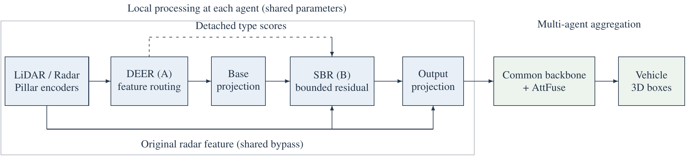

# Evidence Routing and Supported Residuals for Cooperative LiDAR–Radar Perception

**Anonymous Authors**

[Paper](paper/paper.pdf) · [LaTeX source](paper/source/) · [Pretrained Models](https://github.com/Hqa77880011/CSCWD-DEER-SBR/releases/tag/v1.0.0) · [Reference Protocol](#experimental-protocol) · [Supplemental Experiments](#supplemental-experiments) · [Server Training Commands](#server-training-commands) · [Citation](#citation)

This repository provides the reference implementation, pretrained models, and reproducible evaluation pipeline for the accompanying manuscript, **Evidence Routing and Supported Residuals for Cooperative LiDAR–Radar Perception**.

The original seven-model release uses `teacher_free_v4` (schema 4). Supplemental experiments use `supplement_v1` (schema 5), with independent configurations and output directories. The AP results and released checkpoints below belong to the original experiments; the supplemental implementation has passed local functional checks and awaits real-data training and evaluation.

Documentation: [Reproduction guide](docs/REPRODUCING.md) · [Supplemental experiment plan and implementation](docs/13_补充实验方案与实施说明.md) · [Validation records](docs/VALIDATION.md). These detailed guides are currently in Chinese.

## Overview

Missing LiDAR returns and spurious echoes require different responses when constructing features for cooperative perception. The proposed method processes local LiDAR–radar observations before a shared cooperative detection backbone:

- **DEER** predicts independent missing and spurious evidence from traceable deletion/injection supervision. Detached type scores guide feature routing while retaining a positive gain for each available modality.
- **SBR** selects nearby measured radar donors, including a null option, and predicts a residual constrained by observation support and current feature amplitude. Detection supervision learns the correction direction without a feature teacher.



*Local feature processing is followed by the common AttFuse cooperative backbone and Vehicle detection head. The architecture figure is available as an [editable PowerPoint](paper/source/figures/architecture.pptx) and [vector PDF](paper/source/figures/architecture.pdf).*

The reference release includes seven configurations: an internal baseline (**S0**), the individual modules (**A**, **B**), their combination (**AB**), an ordinary gating/residual control (**SUP**), and amplitude/type-prior controls (**N1**, **N2**). The supplemental implementation adds mechanism controls, external-method comparisons, additional data protocols, and a second cooperative backbone.

## Main Results

Vehicle **AP3D at IoU = 0.7 (%)** on the V2X-R test split. All configurations use training seed 17 and a 20-epoch budget. Each weather condition contains **3,166 cooperative samples and 30,296 ground-truth boxes**.

| Configuration | Normal | Fog | Snow | Fog/Snow Mean |
|---|---:|---:|---:|---:|
| S0 — internal baseline | 65.46 | 51.25 | 45.67 | 48.46 |
| A — DEER | 64.67 | 51.60 | 46.22 | 48.91 |
| B — SBR | 65.18 | 51.41 | 44.72 | 48.06 |
| AB — DEER + SBR | 65.19 | 51.07 | **49.19** | 50.13 |
| SUP — ordinary gating/residual control | 64.84 | 51.36 | 46.24 | 48.80 |
| N1 — normalized-mean descriptor | 64.37 | 51.03 | 48.69 | 49.86 |
| N2 — multiplicative type prior | **65.87** | **52.52** | 48.73 | **50.62** |

AB improves Snow AP3D@0.7 by **3.52 percentage points** and the Fog/Snow mean by **1.67 points** relative to S0, with small decreases in Normal and Fog. N2 achieves the highest weather mean. Snow was excluded from training and model selection in this reference batch. Its published test scores are excluded from subsequent structure-selection decisions.

Full-precision results, AP3D/APBEV at IoU thresholds 0.3/0.5/0.7, checkpoint identities, and experiment manifests are available in [`results/reference/`](results/reference/).

## Installation

### Requirements

- Linux x86_64 and Python 3.10.
- An NVIDIA GPU and a CUDA 12.1 development toolkit, including `nvcc`.
- PyTorch 2.1.2+cu121 and torchvision 0.16.2+cu121.
- Approximately 220 GiB of free disk space for dataset preparation; additional space for checkpoints and predictions.

The reference experiments used RTX 2080 Ti devices reporting approximately 22 GB of memory per GPU. Memory requirements on the standard 11 GB configuration need to be assessed separately.

```bash
sudo apt-get update
sudo apt-get install -y git gh build-essential aria2 p7zip-full libgl1 libglib2.0-0

# Authenticate with an account that can access this private repository.
gh auth login
gh auth setup-git

git clone https://github.com/Hqa77880011/CSCWD-DEER-SBR.git
cd CSCWD-DEER-SBR

conda env create -f environment.yml
conda activate cscwd-repro
bash scripts/install.sh
```

The installation script installs the pinned dependencies, builds the Cython/CUDA extensions, and checks GPU operations. Dependency versions are specified in [`requirements-repro.txt`](requirements-repro.txt) and [`requirements-repro-lock.txt`](requirements-repro-lock.txt).

## Dataset Preparation

The experiments use the authors' V2X-R point clouds at revision [`4c9ff1773b49517464714368d30778b5252bdbd0`](https://huggingface.co/datasets/hx24/V2X-R/tree/4c9ff1773b49517464714368d30778b5252bdbd0). The source data contains **8,083 training**, **829 validation**, and **3,166 test** cooperative samples.

```bash
# Optional: verify access to the pinned dataset revision.
python scripts/prepare_data.py --data-root /path/to/v2xr --probe-only

# Download, verify, extract, and build the fixed ground-truth manifest.
python scripts/prepare_data.py --data-root /path/to/v2xr --workers 2
```

The preparation pipeline verifies source checksums, preserves point clouds and annotations, and records image dimensions for geometric field-of-view filtering. RGB pixels are discarded and are not model inputs. Interrupted downloads can be resumed by repeating the command.

An existing dataset prepared with this project's manifests can be reused by supplying its path through `--data-root`.

## Pretrained Models and Evaluation

The [v1.0.0 release](https://github.com/Hqa77880011/CSCWD-DEER-SBR/releases/tag/v1.0.0) contains the original selected checkpoints used for the reported results. Each checkpoint is approximately 302 MB and retains its frozen, train-refitted batch-normalization statistics.

| Configuration | Selected Epoch | Checkpoint |
|---|---:|---|
| S0 | 20 | [S0-selected.pt](https://github.com/Hqa77880011/CSCWD-DEER-SBR/releases/download/v1.0.0/S0-selected.pt) |
| A | 20 | [A-selected.pt](https://github.com/Hqa77880011/CSCWD-DEER-SBR/releases/download/v1.0.0/A-selected.pt) |
| B | 20 | [B-selected.pt](https://github.com/Hqa77880011/CSCWD-DEER-SBR/releases/download/v1.0.0/B-selected.pt) |
| AB | 20 | [AB-selected.pt](https://github.com/Hqa77880011/CSCWD-DEER-SBR/releases/download/v1.0.0/AB-selected.pt) |
| SUP | 20 | [SUP-selected.pt](https://github.com/Hqa77880011/CSCWD-DEER-SBR/releases/download/v1.0.0/SUP-selected.pt) |
| N1 | 18 | [N1-selected.pt](https://github.com/Hqa77880011/CSCWD-DEER-SBR/releases/download/v1.0.0/N1-selected.pt) |
| N2 | 18 | [N2-selected.pt](https://github.com/Hqa77880011/CSCWD-DEER-SBR/releases/download/v1.0.0/N2-selected.pt) |

Shared [evaluation metadata](https://github.com/Hqa77880011/CSCWD-DEER-SBR/releases/download/v1.0.0/evaluation-metadata.tar.gz), a [release manifest](https://github.com/Hqa77880011/CSCWD-DEER-SBR/releases/download/v1.0.0/pretrained-release.json), and [SHA256 checksums](https://github.com/Hqa77880011/CSCWD-DEER-SBR/releases/download/v1.0.0/SHA256SUMS) are also provided. The complete download is approximately 2.02 GiB. Downloads require repository access.

### Evaluate the joint model

After installing the environment and preparing the dataset:

```bash
# Download AB and the shared metadata; verify SHA256 automatically.
python scripts/pretrained.py download --variant AB

# Evaluate the selected AB checkpoint on Normal, Fog, and Snow.
CUDA_VISIBLE_DEVICES=0 python scripts/pretrained.py evaluate \
  --data-root /path/to/v2xr \
  --variant AB --weather all --allow-test-evaluation
```

To reproduce the Snow result alone:

```bash
CUDA_VISIBLE_DEVICES=0 python scripts/pretrained.py evaluate \
  --data-root /path/to/v2xr --variant AB --weather snow \
  --output-root outputs/ab_snow --allow-test-evaluation
```

The reference AB/Snow AP3D@0.7 is **49.19382268909672%**.

### Evaluate all configurations

```bash
python scripts/pretrained.py download --variant all
python scripts/pretrained.py verify --variant all

CUDA_VISIBLE_DEVICES=0 python scripts/pretrained.py evaluate \
  --data-root /path/to/v2xr \
  --variant all --weather all --allow-test-evaluation
```

This command runs 21 complete test evaluations sequentially. Predictions, AP3D/APBEV results, and comparisons with the reference AP3D@0.7 are written to:

```text
outputs/pretrained_evaluation/<variant>/<weather>/
  predictions.jsonl
  predictions.jsonl.meta.json
  scores.json.gz
  summary.json
```

`summary.json` reports AP values on a 0–1 scale and `AP3D07_delta_pp` in percentage points. Existing outputs are preserved; use a new `--output-root` for another evaluation. The default exporter uses eight CPU postprocessing workers; set `--postprocess-workers 1` for serial postprocessing.

The evaluation entrypoint supports relocated data paths while verifying the original checkpoint, configuration, scientific source, data-file identities, and frozen BN statistics. Evaluation uses the selected weights directly, with no training or BN refitting. Numerical differences may arise across GPU architectures or toolchains.

## Training from Scratch

Generate the seven experiment configurations and verify the training inputs:

```bash
python scripts/reproduce.py configure --data-root /path/to/v2xr
python scripts/reproduce.py audit
python scripts/reproduce.py preflight --variant all
python scripts/reproduce.py smoke --variant AB
```

Train all configurations from their shared initialization policy:

```bash
CUDA_VISIBLE_DEVICES=0 python scripts/reproduce.py train --variant all
```

Evaluate the checkpoints selected during training:

```bash
CUDA_VISIBLE_DEVICES=0 python scripts/reproduce.py evaluate \
  --variant all --allow-test-evaluation
```

Use `--variant S0`, `A`, `B`, `AB`, `SUP`, `N1`, or `N2` to run an individual configuration. Resume training with `--resume <path/to/latest.rank0.pt>`. Online resume checkpoints and selected evaluation checkpoints have distinct roles.

## Experimental Protocol

| Component | Setting |
|---|---|
| Training protocol | `teacher_free_v4`, schema 4 |
| Evaluation protocol | `project_fix_v1` |
| Training budget | 20 epochs; 20,200 optimizer updates per configuration |
| Random seed | 17 |
| Precision and batch size | FP32; microbatch 4; accumulation 2; effective batch 8 |
| Training weather | Normal and Fog |
| Model selection | Mean Normal/Fog validation AP3D@0.7 |
| BN evaluation statistics | Refit on 32 fixed training samples; frozen during evaluation |
| Snow | Final testing of frozen models |
| Test postprocessing | Score floor 0.001; rotated BEV NMS IoU 0.15; at most 500 predictions per sample |

Ground truth is fixed across weather conditions, with an ego-frame center ROI of x ∈ [0, 140) m and y ∈ [−40, 40) m and a geometric camera field of view. Ground-truth acceptance is independent of weather-specific point counts. AP uses global confidence ordering and VOC2010 all-points interpolation. The reported weather mean is the arithmetic mean of Fog and Snow AP3D@0.7.

Exact executed configurations are stored in [`repro/configs/`](repro/configs/). The original reproduction and pretrained-evaluation entrypoints load the frozen scientific source from [`repro/archive/legacy_v4_runtime.zip`](repro/archive/legacy_v4_runtime.zip), preserving the original configuration and checkpoint identities. The [reproduction guide](docs/REPRODUCING.md) covers checkpoint recovery, data preparation, and protocol checks.

## Supplemental Experiments

[`scripts/supplement.py`](scripts/supplement.py) provides the supplemental CLI and calls the existing project runner. The experiment matrix is defined in [`cscwd_configs/supplement/matrix.json`](cscwd_configs/supplement/matrix.json); dataset templates are available for [V2X-R](cscwd_configs/supplement/v2xr.yaml), [V2X-Radar-C](cscwd_configs/supplement/v2xradar.yaml), and [K-Radar](cscwd_configs/supplement/kradar.yaml).

| Experiment block | Implemented scope |
|---|---|
| Training budgets and repeats | Independent 20/30/60/90-epoch recipes with matching learning-rate schedules; seeds 17/29/43; actual updates, losses, learning rates, development scores, and selected epochs |
| Mechanism controls | S0/A/B/AB/SUP/N1/N2, M1–M6, NO_NULL, residual bound `rho`, support radius, and inference-time signal interventions |
| External methods and second backbone | AttFuse, AttFuse+MDD, L4DR, CoBEVT, and Where2comm; paired Where2comm baseline/+F with shared common-parameter initialization |
| Data protocols | V2X-R fixed GT; V2X-Radar-C vehicle ego with its real roadside partner; K-Radar as a single-vehicle input, with dataset-specific coordinates, classes, ROI, and evaluators |
| Robustness and diagnostics | Deletion, injection, coexistence, radar retention, missing modalities, heterogeneous agents, ego-only/agent count, localization, and asynchronous inputs; type, routing, donor, support, and residual-amplitude diagnostics |
| Statistical and efficiency analysis | Paired-seed summaries, within-seed weather means, budget comparisons, sequence bootstrap with AP recomputation, and CUDA-synchronized timing with explicit processing boundaries |

`F` denotes one AB or N2 structure frozen from the complete S0/AB/N2 development runs for all three seeds. It has **not yet been selected**. Development selection, training-only BN handling, and final testing are separate; `latest.rank0.pt`, `selected.pt`, and `budget_epochNNN.pt` retain distinct roles.

External comparisons use the V2X-R authors' LiDAR–radar implementations and registered candidate recipes. The `_native` suffix identifies the source of budget/hyperparameters; it does not certify reproduction of the full original paper protocol. The [method audit](docs/13_补充实验方案与实施说明.md#82-原文作者版本与当前适配的核查结论) records the papers, pinned author commits, implementation corrections, shared-protocol adaptations, and remaining evidence gaps.

L4DR is a four-channel adaptation with FAD, foreground supervision, bidirectional MME, and MSGF. FAD scores are detached before hard voxelization, following the author implementation; the foreground loss trains FAD. Its K-Radar candidate uses 35 epochs, batch 3, AdamW (`eps=1e-8`), and the author's per-update cosine schedule with a one-epoch `T_max`. MDD retains its diffusion/reference objective but uses a Normal-frame reference on V2X-R, whereas the author reader removes labeled weather points from the current frame. Real-data MDD-CORR requires verified clear training frames and traceable corruption. Natural rain is not a clean reference.

CoBEVT retains the V2X-R SwapFusion detection adaptation, including masks and spatial padding/cropping. Where2comm and +F share the same V2X-R single-round communication selection and multiscale backbone; this version does not implement the original paper's complete request/multiround and SCM/SPE fusion design. Their existing project epoch-based warmup/cosine schedule is an explicitly registered difference from the author scheduler call chain. No new AP or CUDA performance results are reported. HRCP and REL have no executable configurations pending sufficient implementation evidence.

For independent recipes, omitting `configure --epochs` uses the dataset template: 60 for V2X-R and 30 for V2X-Radar-C/K-Radar. Suites use their matrix budgets; native candidate slots use their source budgets. Method/hypes, variant/module, budget/schedule, and BN-policy mismatches are rejected. Internal execution switches and auxiliary-loss weights are disabled for external methods without a local DEER/SBR module. See [effective configuration and resource units](docs/REPRODUCING.md#01-有效配置参数范围与恢复身份).

After installing the environment, inspect the CLI or run the synthetic CPU check without a dataset or pretrained weights:

```bash
python scripts/supplement.py --help
python scripts/supplement.py smoke
```

The smoke check performs synthetic forward, backward, and inference passes with zero optimizer updates and produces no AP results.

<a id="server-training-commands"></a>

### Staged Server Training Commands

For a minimal check immediately after pulling the latest code, use the [server validation commands without training](docs/REPRODUCING.md#minimal-server-validation). They execute L4DR CUDA known answers, spconv voxelization and forward/backward checks, and two prepared training samples per requested dataset, with no optimizer step or checkpoint creation.

Run the following stages on a **Linux server with the project environment installed and the datasets prepared**. Set the server paths first, then use the same Bash session throughout. Each `run-suite --execute` command starts real training. Tasks within a suite run sequentially; `--skip-completed` checks the full configuration, current source/data identities, successful report, and selected-checkpoint identity/role before reusing a pilot. These commands have been checked locally and await execution on the server.

Stage order: environment preflight → optional execution-configuration measurements → S0/AB/N2 with seed 17 → SUP with seed 17 → freeze the training budget from development curves → internal/external three-seed runs → freeze F → M1/M3/M4 → extensions required by the research questions. External methods can run on separate GPUs alongside the internal experiments. Stages that depend on F require complete development evidence from all three seeds.

#### Stage 0: Set Server Paths and Preflight Helpers

Use a new supplemental campaign directory for `RUNS`. `CUDA_VISIBLE_DEVICES` selects the physical GPU; the process uses `DEVICE=cuda:0`. `EPOCHS=60` is the initial pilot candidate. Internal configurations retain FP32, microbatch size 4, gradient accumulation over 2 microbatches, and effective batch size 8. External methods retain their method-specific candidate batches and registered schedules. The L4DR corrections require a new supplemental campaign; use the archived entrypoints for the original seven-model release.

```bash
# Set these three paths to their actual locations on the Linux server.
export REPO=/data/projects/CSCWD-DEER-SBR
export DATA=/data/v2xr
export RUNS=/data/runs/supplement_v1_20261024

cd "$REPO"
conda activate cscwd-repro
set -euo pipefail
export PYTHONUTF8=1
export OMP_NUM_THREADS=1 MKL_NUM_THREADS=1 OPENBLAS_NUM_THREADS=1
export CUDA_VISIBLE_DEVICES=0
DEVICE=cuda:0
EPOCHS=60
PLANS="$RUNS/plans"
CHECKS="$RUNS/checks"
LOGS="$RUNS/logs"
REPORTS="$RUNS/reports"
FINAL_MODEL="$RUNS/frozen_final.json"
EXECUTION_ARGS=()  # After measuring and freezing execution settings, use (--execution-config "$WINNER").
mkdir -p "$PLANS" "$CHECKS" "$LOGS" "$REPORTS"
git rev-parse HEAD | tee "$CHECKS/repository_commit.txt"
```

For each stage, run `plan --write-configs`, then `check_plan`, and finally the training command. The helpers below check the paths and `formal_blockers` in each preflight report and read two real training samples. The `preflight` exit code alone does not establish training readiness.

```bash
check_config() {
  local config="$1"
  local run_id
  run_id="$(basename "$config" .yaml)"
  python scripts/supplement.py preflight --config "$config" \
    > "$CHECKS/preflight_${run_id}.json"
  python - "$CHECKS/preflight_${run_id}.json" <<'PY'
import json
import sys
from pathlib import Path
report = json.loads(Path(sys.argv[1]).read_text())
missing = [k for k, v in report['paths'].items() if not v['exists']]
if report['formal_blockers'] or missing:
    raise SystemExit(f"BLOCKED: {report['formal_blockers']}; missing paths: {missing}")
print('PASS preflight:', sys.argv[1])
PY
  python scripts/supplement.py check-data --config "$config" --samples 2 \
    | tee "$CHECKS/input_${run_id}.log"
}

check_plan() {
  local config
  while IFS= read -r config; do
    check_config "$config"
  done < <(python -c \
    'import json,sys; print("\n".join(t["config"] for t in json.load(open(sys.argv[1]))["tasks"]))' \
    "$1")
}
```

#### Stage 1: Check the Environment and Data

```bash
nvidia-smi
python -m pip check

# Inspect dependency imports and device availability without downloading or reading data.
python scripts/supplement.py environment --native-v2xr --device "$DEVICE" \
  --output "$CHECKS/environment.json"

# Check CUDA operations, spconv, a synthetic baseline, and checkpoint handling.
python project_tools/check_environment.py --output "$CHECKS/environment_gpu.json" \
  | tee "$LOGS/environment_gpu.log"

# Check 21 synthetic CPU forward/backward/inference paths; zero optimizer updates and no AP.
python scripts/supplement.py smoke --output "$CHECKS/synthetic_smoke.json"
```

Proceed when the dependency report is `ready`, the synthetic GPU environment check is `passed`, and every subsequent configuration has `formal_blockers=[]` with readable training samples. V2X-R must already contain the fixed-GT manifest and the data, split, and weather manifests.

#### Stage 1A: Optional Execution-Configuration Measurements

Compare 4 and 8 data-loader workers first. The commands below run 10 warmup updates and 40 measured updates per candidate on real training data. These bounded benchmarks write to a separate `performance/` directory and do not count toward the formal pilots.

```bash
export OMP_NUM_THREADS=1 MKL_NUM_THREADS=1 OPENBLAS_NUM_THREADS=1
PERF="$RUNS/performance"
mkdir -p "$PERF"
BASE="$(python scripts/supplement.py configure --dataset v2xr --method deer_sbr \
  --variant AB --seed 17 --epochs "$EPOCHS" --data-root "$DATA" \
  --output-root "$PERF/base" --device "$DEVICE")"
check_config "$BASE"

# Generate two worker-count candidates and their benchmark commands without running them.
python scripts/supplement.py performance-configs --config "$BASE" --stage workers \
  --output-root "$PERF/workers_r1" > "$PERF/workers_r1.json"

# Use the same seed and sample order: 10 warmup + 40 measured updates per candidate.
while IFS= read -r C; do
  python project_tools/run_experiments.py --config "$C" --mode benchmark \
    --warmup 10 --steps 40 --timing-mode throughput
done < <(python -c 'import json,sys; print("\n".join(t["config"] for t in json.load(open(sys.argv[1]))["tasks"]))' \
  "$PERF/workers_r1.json")
```

Then compare one factor at a time as needed: prefetch factors 1/2, raw caches of 0.5/1.0 GiB per worker, `cpu_threads` 2/4, activation checkpointing enabled/disabled, and checkpoint intervals of 100/500/1000 updates. See the [performance measurement procedure](docs/REPRODUCING.md#12-分阶段候选配置与有界服务器测量) for generation commands, total RAM accounting, and selection criteria. To use measured execution settings, set the array below **before generating the formal pilot configurations for the first time**. Otherwise, keep `EXECUTION_ARGS=()`.

```bash
# Set WINNER to the full candidate YAML selected from actual measurements.
: "${WINNER:?set WINNER to the measured winning YAML}"
EXECUTION_ARGS=(--execution-config "$WINNER")
```

Keep execution settings consistent between pilots and repeated runs. This option copies only resource settings, supported local activation checkpointing, and the online-checkpoint interval. Each method retains its registered optimizer, batch size, schedule, and BN policy. `preflight` reports per-task loader/cache/prefetch bounds; add them across concurrent jobs and measure the full process tree's RAM. `cpu_threads` limits main-process PyTorch threads; the OMP/MKL/OpenBLAS environment settings above also apply to workers.

#### Stage 2: Run S0 / AB / N2 with Seed 17, Then SUP

```bash
# EXECUTION_ARGS is empty by default; retain frozen execution settings for matching repeats.
python scripts/supplement.py plan --suite pilot --epochs "$EPOCHS" \
  --data-root "$DATA" --output-root "$RUNS" --device "$DEVICE" "${EXECUTION_ARGS[@]}" --write-configs \
  | tee "$PLANS/pilot.json"
check_plan "$PLANS/pilot.json"
python scripts/supplement.py run-suite --suite pilot --epochs "$EPOCHS" \
  --data-root "$DATA" --output-root "$RUNS" --device "$DEVICE" "${EXECUTION_ARGS[@]}" \
  --execute --skip-completed | tee -a "$LOGS/pilot_e${EPOCHS}.log"

python scripts/supplement.py plan --suite pilot_sup --epochs "$EPOCHS" \
  --data-root "$DATA" --output-root "$RUNS" --device "$DEVICE" "${EXECUTION_ARGS[@]}" --write-configs \
  | tee "$PLANS/pilot_sup.json"
check_plan "$PLANS/pilot_sup.json"
python scripts/supplement.py run-suite --suite pilot_sup --epochs "$EPOCHS" \
  --data-root "$DATA" --output-root "$RUNS" --device "$DEVICE" "${EXECUTION_ARGS[@]}" \
  --execute --skip-completed | tee -a "$LOGS/pilot_sup_e${EPOCHS}.log"

PILOT_RUNS=()
for V in S0 AB N2 SUP; do
  PILOT_RUNS+=("$RUNS/supp_v2xr_deer_sbr_${V}_e${EPOCHS}_s17/train")
done
python scripts/supplement.py convergence --run-dirs "${PILOT_RUNS[@]}" \
  --output "$REPORTS/pilot_e${EPOCHS}_convergence.json"
```

Each run writes to `$RUNS/<run_id>/train/`, including `steps.rank0.jsonl`, `telemetry.rank0.jsonl`, per-epoch `validation_epochNNN.json`, online/selected checkpoints, and budget snapshots. `convergence` exports development curves as JSON, CSV, and PNG.

#### Stage 2A: Compare Independent Budgets If Needed, Then Freeze EPOCHS

The example below compares one independent 30-epoch recipe. Set `E=20` for a 20-epoch control; consider `E=90` only if development performance is still improving at 60 epochs. The full four-configuration × four-budget `budgets` matrix is not launched by default.

```bash
E=30
for SUITE in pilot pilot_sup; do
  python scripts/supplement.py plan --suite "$SUITE" --epochs "$E" \
    --data-root "$DATA" --output-root "$RUNS" --device "$DEVICE" "${EXECUTION_ARGS[@]}" --write-configs \
    | tee "$PLANS/${SUITE}_e${E}.json"
  check_plan "$PLANS/${SUITE}_e${E}.json"
  python scripts/supplement.py run-suite --suite "$SUITE" --epochs "$E" \
    --data-root "$DATA" --output-root "$RUNS" --device "$DEVICE" "${EXECUTION_ARGS[@]}" \
    --execute --skip-completed | tee -a "$LOGS/${SUITE}_e${E}.log"
done
BUDGET_RUNS=()
for V in S0 AB N2 SUP; do
  BUDGET_RUNS+=("$RUNS/supp_v2xr_deer_sbr_${V}_e${E}_s17/train")
done
python scripts/supplement.py convergence --run-dirs "${BUDGET_RUNS[@]}" \
  --output "$REPORTS/budget_e${E}_convergence.json"
```

Choose the final budget from development curves. A run is a plateau candidate once both learning-rate reductions have occurred, the best development mean has improved by less than 0.3 percentage points over the last 10 epochs, and no sustained upward trend remains. The epoch-30 snapshot of a 60-epoch recipe is not an independent 30-epoch endpoint. Set subsequent `EPOCHS` values to the frozen budget of 20, 30, 60, or 90; test scores must not determine this choice.

#### Stage 3: Run External-Method Pilots with Seed 17

AttFuse, MDD, and L4DR use 30 epochs; CoBEVT uses 40. **Do not pass `--epochs` in this stage.** These runs can use another GPU while retaining the common data/fixed-GT protocol and each method's registered source-based candidate.

```bash
python scripts/supplement.py plan --suite external_pilot \
  --data-root "$DATA" --output-root "$RUNS" --device "$DEVICE" "${EXECUTION_ARGS[@]}" --write-configs \
  | tee "$PLANS/external_pilot.json"
check_plan "$PLANS/external_pilot.json"
python scripts/supplement.py run-suite --suite external_pilot \
  --data-root "$DATA" --output-root "$RUNS" --device "$DEVICE" "${EXECUTION_ARGS[@]}" \
  --execute --skip-completed | tee -a "$LOGS/external_pilot.log"
```

#### Stage 4: Complete Three Seeds for Six Internal Configurations and Four External Methods

The internal matrix contains S0/A/B/AB/SUP/N2 × seeds 17/29/43, for 18 runs. Four external methods × three seeds add 12 runs. Completed pilots with identical recipes are skipped. Historical 20-epoch results do not automatically count toward a new longer budget. Adjust `EPOCHS=60` below to the budget selected from the preceding development stage.

```bash
# Set this to the frozen development-based budget before generating all repeated runs.
EPOCHS=60
python scripts/supplement.py plan --suite internal_main --epochs "$EPOCHS" \
  --data-root "$DATA" --output-root "$RUNS" --device "$DEVICE" "${EXECUTION_ARGS[@]}" --write-configs \
  | tee "$PLANS/internal_main.json"
check_plan "$PLANS/internal_main.json"
python scripts/supplement.py run-suite --suite internal_main --epochs "$EPOCHS" \
  --data-root "$DATA" --output-root "$RUNS" --device "$DEVICE" "${EXECUTION_ARGS[@]}" \
  --execute --skip-completed | tee -a "$LOGS/internal_main_e${EPOCHS}.log"

python scripts/supplement.py plan --suite external_main \
  --data-root "$DATA" --output-root "$RUNS" --device "$DEVICE" "${EXECUTION_ARGS[@]}" --write-configs \
  | tee "$PLANS/external_main.json"
check_plan "$PLANS/external_main.json"
python scripts/supplement.py run-suite --suite external_main \
  --data-root "$DATA" --output-root "$RUNS" --device "$DEVICE" "${EXECUTION_ARGS[@]}" \
  --execute --skip-completed | tee -a "$LOGS/external_main.log"
```

#### Stage 5: Freeze F Using Development Evidence from All Three Seeds

This stage requires complete development logs and selected checkpoints for S0/AB/N2 × seeds 17/29/43. Choose AB or N2 by the Normal/Fog development mean, subject to a three-seed mean Normal decrease of at most 1 percentage point relative to S0; select AB on an exact tie. F is one shared structure. V2X-R reuses the already trained checkpoint for that structure at each seed.

```bash
DEV_RUNS=()
for V in S0 AB N2; do
  for S in 17 29 43; do
    DEV_RUNS+=("$RUNS/supp_v2xr_deer_sbr_${V}_e${EPOCHS}_s${S}/train")
  done
done
python scripts/supplement.py convergence --run-dirs "${DEV_RUNS[@]}" \
  --output "$REPORTS/main_development_e${EPOCHS}.json"
python scripts/supplement.py freeze-final --run-dirs "${DEV_RUNS[@]}" \
  --normal-tolerance-pp 1 --output "$FINAL_MODEL"
F_VARIANT="$(python -c \
  'import sys; from opencood.project.supplement import resolve_final; print(resolve_final(sys.argv[1]))' \
  "$FINAL_MODEL")"
printf 'Frozen F = %s\n' "$F_VARIANT"
```

#### Stage 6: Prioritize M1 / M3 / M4

Run seed 17 first, then add seeds 29/43. All three controls are based on AB; if F is N2, they do not constitute a complete N2 ablation. Complete the repeats when the corresponding mechanism claims are retained in the manuscript.

```bash
for SUITE in mechanism_pilot mechanism_repeat; do
  python scripts/supplement.py plan --suite "$SUITE" --epochs "$EPOCHS" \
    --data-root "$DATA" --output-root "$RUNS" --device "$DEVICE" "${EXECUTION_ARGS[@]}" --write-configs \
    | tee "$PLANS/${SUITE}.json"
  check_plan "$PLANS/${SUITE}.json"
  python scripts/supplement.py run-suite --suite "$SUITE" --epochs "$EPOCHS" \
    --data-root "$DATA" --output-root "$RUNS" --device "$DEVICE" "${EXECUTION_ARGS[@]}" \
    --execute --skip-completed | tee -a "$LOGS/${SUITE}.log"
done
```

#### Stage 6A: Run Additional Mechanism Controls as Required

The optional matrix contains M2/M5/M6/N1/NO_NULL × seeds 17/29/43, for 15 runs. Enable controls according to the predefined research questions; do not retain or discard experiments based on test performance.

```bash
python scripts/supplement.py plan --suite mechanism_optional --epochs "$EPOCHS" \
  --data-root "$DATA" --output-root "$RUNS" --device "$DEVICE" "${EXECUTION_ARGS[@]}" --write-configs \
  | tee "$PLANS/mechanism_optional.json"
check_plan "$PLANS/mechanism_optional.json"
python scripts/supplement.py run-suite --suite mechanism_optional --epochs "$EPOCHS" \
  --data-root "$DATA" --output-root "$RUNS" --device "$DEVICE" "${EXECUTION_ARGS[@]}" \
  --execute --skip-completed | tee -a "$LOGS/mechanism_optional.log"
```

#### Stage 7: Compare rho / Support Radius and the Second Cooperative Backbone

A valid `$FINAL_MODEL` must exist before this stage. The rho and radius suites each contain three separate comparisons with seed 17 by default. The Where2comm baseline and +F each use three seeds, for six runs with the native 40-epoch recipe.

```bash
for SUITE in rho radius; do
  python scripts/supplement.py plan --suite "$SUITE" --epochs "$EPOCHS" \
    --data-root "$DATA" --output-root "$RUNS" --device "$DEVICE" "${EXECUTION_ARGS[@]}" \
    --final-model-file "$FINAL_MODEL" --write-configs | tee "$PLANS/${SUITE}.json"
  check_plan "$PLANS/${SUITE}.json"
  python scripts/supplement.py run-suite --suite "$SUITE" --epochs "$EPOCHS" \
    --data-root "$DATA" --output-root "$RUNS" --device "$DEVICE" "${EXECUTION_ARGS[@]}" \
    --final-model-file "$FINAL_MODEL" --execute --skip-completed \
    | tee -a "$LOGS/${SUITE}.log"
done

# Where2comm baseline and +F across three seeds: six native 40-epoch runs; omit --epochs.
python scripts/supplement.py plan --suite second_backbone \
  --data-root "$DATA" --output-root "$RUNS" --device "$DEVICE" "${EXECUTION_ARGS[@]}" \
  --final-model-file "$FINAL_MODEL" --write-configs | tee "$PLANS/second_backbone.json"
check_plan "$PLANS/second_backbone.json"
python scripts/supplement.py run-suite --suite second_backbone \
  --data-root "$DATA" --output-root "$RUNS" --device "$DEVICE" "${EXECUTION_ARGS[@]}" \
  --final-model-file "$FINAL_MODEL" --execute --skip-completed \
  | tee -a "$LOGS/second_backbone.log"
```

#### Stage 8: Extend to Real Cooperative Data with V2X-Radar-C

Run this stage once the official cooperative data is available on the server. Hold out development sequences from the official training split and reserve the official validation split for final evaluation. Inputs use the actual vehicle ego and roadside partner. Populate `CLEAR_SEQS` only with verified clear-weather training sequences. An empty array blocks preflight for the complete suite when type supervision or an MDD reference is required.

```bash
REAL=/data/v2x-radar-c
REAL_META=/data/metadata/v2xradar_supp_v1_20261024
REAL_RUNS=/data/runs/v2xradar_supp_v1_20261024
mkdir -p "$REAL_RUNS/plans"
# Include only verified clear-weather sequences from official train; do not infer weather from names.
CLEAR_SEQS=()
python scripts/supplement.py prepare --dataset v2xradar --data-root "$REAL" \
  --manifest-dir "$REAL_META" --dev-count 4 --split-seed 17 \
  --clean-sequences "${CLEAR_SEQS[@]}"

python scripts/supplement.py plan --suite real_cooperative --data-root "$REAL" \
  --manifest-dir "$REAL_META" --output-root "$REAL_RUNS" --device "$DEVICE" \
  --final-model-file "$FINAL_MODEL" --write-configs \
  | tee "$REAL_RUNS/plans/real_cooperative.json"
check_plan "$REAL_RUNS/plans/real_cooperative.json"
python scripts/supplement.py run-suite --suite real_cooperative --data-root "$REAL" \
  --manifest-dir "$REAL_META" --output-root "$REAL_RUNS" --device "$DEVICE" \
  --final-model-file "$FINAL_MODEL" --execute --skip-completed \
  | tee -a "$LOGS/real_cooperative.log"
```

The main matrix contains S0/F/MDD-CORR/CoBEVT × three seeds. The separate L4DR candidate below can be run when required. If a valid clean MDD reference is unavailable, resolve the data/supervision requirements before proceeding; naturally rainy frames are not clean targets.

```bash
# Separate L4DR candidate across three seeds; no MDD clean target is required.
python scripts/supplement.py plan --suite real_cooperative_l4dr --data-root "$REAL" \
  --manifest-dir "$REAL_META" --output-root "$REAL_RUNS" --device "$DEVICE" --write-configs \
  | tee "$REAL_RUNS/plans/real_cooperative_l4dr.json"
check_plan "$REAL_RUNS/plans/real_cooperative_l4dr.json"
python scripts/supplement.py run-suite --suite real_cooperative_l4dr --data-root "$REAL" \
  --manifest-dir "$REAL_META" --output-root "$REAL_RUNS" --device "$DEVICE" \
  --execute --skip-completed | tee -a "$LOGS/real_cooperative_l4dr.log"
```

#### Stage 9: Extend to Real Weather with K-Radar

Set the paths to the existing OS2-64 data, official sparse radar products, v2.0 labels, and official split files. The main matrix contains S0/F/MDD-CORR/L4DR × three seeds. L4DR uses 35 epochs with AdamW/cosine and batch size 3; the other methods retain their registered recipes. Do not pass `--epochs` to native suites.

```bash
KR=/data/kradar
KR_RADAR=/data/kradar_sparse_product
KR_LABEL=/data/KRadar_refined_label_by_UWIPL
KR_META=/data/metadata/kradar_supp_v1_20261024
KR_RUNS=/data/runs/kradar_supp_v1_20261024
mkdir -p "$KR_RUNS/plans"
python scripts/supplement.py prepare --dataset kradar --data-root "$KR" \
  --radar-root "$KR_RADAR" --label-root "$KR_LABEL" --manifest-dir "$KR_META" \
  --train-split /data/kradar_official_split/train.txt \
  --test-split /data/kradar_official_split/test.txt --dev-count 4 --split-seed 17
python scripts/supplement.py plan --suite real_weather --data-root "$KR" \
  --radar-root "$KR_RADAR" --label-root "$KR_LABEL" --manifest-dir "$KR_META" \
  --output-root "$KR_RUNS" --device "$DEVICE" \
  --final-model-file "$FINAL_MODEL" --write-configs | tee "$KR_RUNS/plans/real_weather.json"
check_plan "$KR_RUNS/plans/real_weather.json"
python scripts/supplement.py run-suite --suite real_weather --data-root "$KR" \
  --radar-root "$KR_RADAR" --label-root "$KR_LABEL" --manifest-dir "$KR_META" \
  --output-root "$KR_RUNS" --device "$DEVICE" --final-model-file "$FINAL_MODEL" \
  --execute --skip-completed | tee -a "$LOGS/real_weather.log"
```

K-Radar uses single-vehicle inputs and two detection classes. MDD requires clear-weather training references supported by official weather records. The two real datasets use separate manifests and output directories, with the same frozen F structure.

#### Any Stage: Resume from an Online Checkpoint

The example below resumes the internal AB/seed-17 run. For other tasks, use the exact run ID and configuration path from their plan JSON.

```bash
C="$RUNS/configs/supp_v2xr_deer_sbr_AB_e${EPOCHS}_s17.yaml"
python scripts/supplement.py train --config "$C" --execute \
  --resume "$RUNS/supp_v2xr_deer_sbr_AB_e${EPOCHS}_s17/train/latest.rank0.pt" \
  | tee -a "$LOGS/resume_AB_e${EPOCHS}_s17.log"
```

`latest.rank0.pt` stores online BN statistics, optimizer, scheduler, sampler, and RNG state for resume. `selected.pt` is the development-selected checkpoint for evaluation; `budget_epochNNN.pt` is an explicit budget snapshot. `--skip-completed` skips completed tasks but does not automatically resume interrupted runs. Keep the source, configuration, and data identities consistent once formal training has started.

Supplemental evaluation binds `retrained` / `fine_tuned` labels to the checkpoint's actual training identity. Configure a separate fine-tuning recipe with `configure --transfer fine_tuned --initialize-from <source-selected.pt>` to freeze its source path and content digest; training and resume require the same source file. Real-data manifests now bind LiDAR/Radar contents, and L4DR records its PointNet++ source and loaded binary identities separately from numerical validation. Older supplemental artifacts without this evidence require a new batch; the original seven configurations, reference results, and Release identities are preserved. See the [configuration and resume contract](docs/REPRODUCING.md#01-有效配置参数范围与恢复身份) and [validation record](docs/VALIDATION.md).

For multiple GPUs, prioritize independent single-GPU tasks. Set `CUDA_VISIBLE_DEVICES=<physical_gpu_id>` separately in each terminal while keeping `device=cuda:0` inside each process. Do not launch two suites concurrently if they contain the same run ID. Sum worker counts, CPU threads, RAM caches, and disk reservations across all concurrent tasks; see the [total resource allocation example](docs/REPRODUCING.md#13-多-gpu-总资源安排).

After freezing development decisions and completing the corresponding training runs, follow the commands for [development diagnostics and efficiency](docs/REPRODUCING.md#43-固定权重的开发诊断干预与效率) and [final evaluation, robustness, and summaries](docs/REPRODUCING.md#6-最终评测鲁棒性与统计汇总). Full development validation already runs automatically after every training epoch. Final tests do not determine the training budget or model structure. Detailed protocols and readiness conditions remain in the [reproduction guide](docs/REPRODUCING.md#补充实验复现入口schema-5).

## Reproducibility Checks

The original release validation passed **159 regression tests**. A complete AB/Snow evaluation reproduced all six reported AP3D/APBEV metrics at IoU 0.3/0.5/0.7, and its prediction archive was byte-identical to the original experiment. Verification records are available in [`repro/pretrained_release_verification.json`](repro/pretrained_release_verification.json).

The supplemental implementation checks on **2026-10-23** covered 18 relevant test modules: **160 passed, 3 skipped, 0 failures or errors**. The three skipped checks require the complete prepared V2X-R dataset. In addition, **21 synthetic CPU model paths** passed forward/backward/inference checks, and **27 CLI calls** passed. Machine-readable records are available in [`results/supplement/`](results/supplement/), with scope and environment details in [VALIDATION.md](docs/VALIDATION.md).

Supplemental real-data training, final evaluation, and CUDA numerical/performance validation remain unexecuted. The local native-data preflight reports missing spconv/cumm, Open3D, pypcd, and compiled extensions. Synthetic checks establish functionality and do not supply experimental AP or efficiency claims.

```bash
bash scripts/test.sh

# Include dataset-dependent regression checks.
CSCWD_DATA_ROOT=/path/to/v2xr bash scripts/test.sh

# Check the arithmetic of the stored reference results without inference.
python scripts/reproduce.py results
```

## Repository Structure

```text
assets/              Architecture figure from the manuscript
paper/               Anonymous manuscript, LaTeX source, editable figure, supporting documents
opencood/            Models, datasets, training protocol, and evaluation
project_tools/       Training, prediction export, and diagnostic utilities
scripts/             Installation, data preparation, and reproduction entrypoints
cscwd_configs/       Project configurations, including the supplemental matrix and templates
repro/               Executed configurations, manifests, and verification records
results/reference/   Reference metrics and experiment identities
results/supplement/  Local supplemental implementation-check records
tests/               Module, geometry, protocol, and evaluation regression tests
docs/                Detailed reproduction and validation documentation
CITATION.cff         Machine-readable software and preferred paper citation
```

Raw datasets, local environments, generated predictions, and compiled extensions are excluded from Git. Pretrained checkpoints and the original evaluation metadata are distributed through GitHub Releases.

## Citation

If you use this implementation or its experimental artifacts, please cite the accompanying manuscript:

```bibtex
@unpublished{anonymous2026evidence,
  author = {{Anonymous Authors}},
  title  = {Evidence Routing and Supported Residuals for Cooperative {LiDAR}--{Radar} Perception},
  year   = {2026},
  note   = {Anonymous manuscript; authorship to be confirmed},
  url    = {https://github.com/Hqa77880011/CSCWD-DEER-SBR/blob/main/paper/paper.pdf}
}
```

The citation is also available in [`CITATION.bib`](CITATION.bib) and [`CITATION.cff`](CITATION.cff). The CFF metadata identifies the manuscript as the preferred citation for this repository.

## Acknowledgments and License

This implementation builds on [V2X-R](https://github.com/ylwhxht/V2X-R) and its OpenCOOD-based framework. We acknowledge the upstream authors and the related codebases credited in the retained [upstream V2X-R README](docs/V2XR_UPSTREAM_README.md), which provides the original benchmark documentation.

Please consult [`NOTICE.md`](NOTICE.md) and the applicable source-file headers for third-party attribution and license terms.
